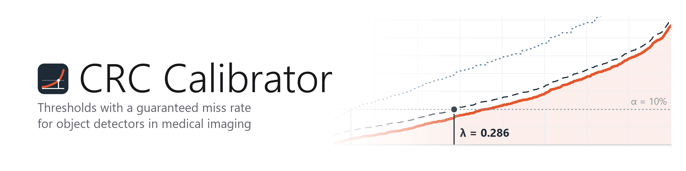

<picture>
  <source media="(prefers-color-scheme: dark)" srcset="docs/banner-dark.png">
  
</picture>

<p align="center">
  <a href="LICENSE"></a>
  
  
  
</p>

Give it the scores of any detector on labelled cases the model has never seen. For each miss budget α it returns
the threshold λ, the guarantee that comes with it, and what it costs in false detections:

- **CRC** (conformal risk control): the mean share of objects missed on a new case is at most α.
- **RCPS-HB / RCPS-WSR** (risk-controlling prediction sets): the same, with probability at least 1 − δ over the
  calibration cases. Needs more cases and gives stricter thresholds.

A case is the unit the guarantee is about: a slide, a patient, a study. The loss of a case is the share of its
annotated objects that the detector missed at threshold λ. The cost is the number of its false detections.
Only the loss is guaranteed. The cost is measured on the same cases.

The methods are from Angelopoulos et al. (ICLR 2024) and Bates et al. (J ACM 2021). This program puts them to work
for object detection in medical images: it matches detections to annotations, groups images into cases, picks
the thresholds, measures their price, and checks the promise on repeated random calibration/test splits.

## Install and start (Windows)

You need Windows 10 or 11 (64-bit), an internet connection for the first start, and about 2 GB of free disk space.
No programming tools are needed.

1. **Download** `CRC-Calibrator-<version>.zip` from the
   [Releases](../../releases) page (the newest is at the top).
2. **Unpack.** Right-click the downloaded file, choose **Extract All…**, and pick a place to keep the program,
   for example *Documents*. Do not start the program from inside the ZIP file.
3. **Start.** Open the extracted folder and double-click **Start CRC Calibrator**.
   - If Windows says *"Windows protected your PC"*, click **More info**, then **Run anyway**. Windows shows this
     for any program downloaded from the internet that is not from a big publisher.
   - The first start downloads Python and the packages the program needs. This takes about 5–10 minutes; a black
     window shows the progress. Keep it open.
   - When it is done, the program opens and a **CRC Calibrator** shortcut appears on your desktop.
4. **Next time**, double-click the desktop shortcut. The program opens in a few seconds.

**Try it:** press **Try the example** in the program to see the results for 40 histology slides. To use your own
data, press **Data guide** in the program: it shows what the files should look like and saves templates.

**If something goes wrong:** start *Start CRC Calibrator* again. If the program does not open, a message names the
problem and a file `crc_calibrator.log` in the program folder holds the details; send it to the author.

**Update:** download and extract the new release, then start it once the same way (the shortcut is updated).
**Remove:** delete the program folder and the desktop shortcut.

## For developers

The program runs through [pixi](https://pixi.sh) (Windows, 64-bit):

```
powershell -ExecutionPolicy ByPass -c "irm -useb https://pixi.sh/install.ps1 | iex"
git clone https://github.com/edlmar/CRC-Calibrator.git
cd CRC-Calibrator
```

```
pixi run gui        # desktop window
pixi run cli scores examples/icc_oof.json --out results/example
pixi run cli coco annotations.coco.json detections.json --case regex --pattern "^(\d+)_" --save-scores scores.csv
```

The first `pixi run` installs Python and the packages. The GUI is a native window (pywebview); it needs no browser.
`Start CRC Calibrator.cmd` does the same for users: it installs pixi and the environment on the first start,
creates the desktop shortcut, and starts the window with `pythonw` (no console; output goes to
`crc_calibrator.log`).

## Input

In the window: drop the files on it (or press **Browse…**). Each file is recognised by its content, so a scores
file, a COCO annotation file, COCO detections and a case table can be dropped together, in any order. **Guide**
shows what the files look like and how to prepare them, and saves template files and two small Python scripts.

**Scores file** (any model): one entry per case.

- JSON: a list of records `{"case": ..., "objects": [...], "false": [...], "group": ...}`. `slide`/`gt_best`/`fp`
  are accepted as well, so `crc/oof.json` from the ICC project reads as is. Records of one case (tiles of a
  slide) are merged.
- CSV: columns `case, kind, score[, group]`. `kind` is `object` (an annotated object; its score is the score of
  the detection that found it, 0 if none) or `false` (a detection that matched no object).

**COCO detection**: the annotation file plus detections in COCO results format
(`[{"image_id", "bbox", "score"}, ...]`). Matching is greedy by score, one-to-one: a detection hits an object
when its centre lies within half the object's larger side (default) or when IoU ≥ a threshold. Images are grouped
into cases by a file-name pattern (first regex group), by a table (`image, case[, group]`), or each image is its
own case. Export the detections with a low score floor (e.g. 0.001) so that every threshold can be evaluated.

`group` (e.g. patient) keeps related cases on the same side of every calibration/test split.

## Output

The window shows the thresholds per budget, the miss curve with the chosen λ, the price in false detections, the
check on random splits and the per-case misses. **Export** writes `report.html`, `thresholds.csv`,
`validation.csv`, `curve.csv`, `scores.csv`, `settings.json` and `figures/*.png|svg`.

## Assumptions

- New cases are exchangeable with the calibration cases: same population, lab, stain, scanner and annotation
  protocol. After any shift, recalibrate.
- Scores come from a model that never saw the calibration cases (held-out or cross-validated predictions).
- The guarantee is about the average case, not each case. With n cases the smallest budget CRC can promise is
  1/(n+1), raised by objects the detector never found: they count as missed at every threshold.

## Example

`examples/icc_oof.json`: interstitial cells of Cajal, 40 histology slides (9 tiles each, 2,027 cells), out-of-fold
RF-DETR Large scores from 5-fold cross-validation by slide (data: Fišere, Edelmers et al., Cells 2025).
CRC thresholds: α = 5% → 0.095, 10% → 0.286, 15% → 0.463, 20% → 0.575; RCPS-HB α = 20%, δ = 0.1 → 0.287.

## Code

- `core/crc.py` selection rules (CRC, RCPS-HB, RCPS-WSR), from the bone-metastasis project `crc_app`
- `core/data.py` readers and detection matching
- `core/analysis.py` loss and cost curves, thresholds, split check
- `core/report.py` figures and the HTML report
- `core/cli.py` command line; `gui/app.py` the window (NiceGUI + pywebview); `gui/guide.py` the data guide and
  its templates

## Citation

If you use CRC Calibrator in your research, please cite it with the methods it implements:

- Angelopoulos AN, Bates S, Fisch A, Lei L, Schuster T. Conformal risk control. ICLR 2024.
- Bates S, Angelopoulos A, Lei L, Malik J, Jordan M. Distribution-free, risk-controlling prediction sets.
  J ACM 2021;68(6):43.

GitHub offers the citation of the program under **Cite this repository**, from [CITATION.cff](CITATION.cff).

## License

[MIT](LICENSE). © 2026 Edgars Edelmers.

## Contact

Edgars Edelmers – edgars.edelmers@disroot.org, or open an [issue](https://github.com/edlmar/CRC-Calibrator/issues).
Mirror: [codeberg.org/edgars_edelmers/crc-calibrator](https://codeberg.org/edgars_edelmers/crc-calibrator).
